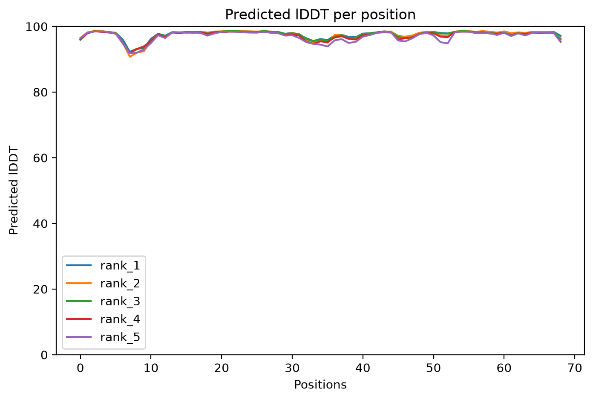
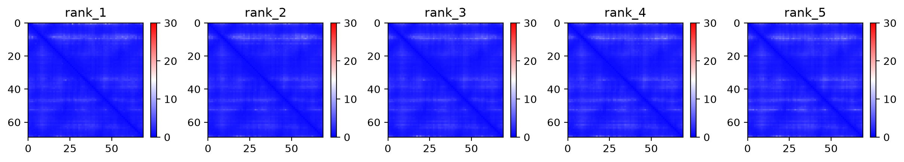

# AlphaFold2 本地部署指南（LocalColabFold · 6GB 笔记本可跑）

> 在 **Ubuntu + RTX 3060 6GB 笔记本**上，用 pip 版 ColabFold **免下载 2-3TB 数据库**跑通 AlphaFold2 单体与复合物预测的完整记录：部署日志 + 踩坑解决 + N1-N6 知识体系 + 已验证 demo。

这个项目适合：**没有 GPU 计算经验、显存有限（6GB 级别）、想在自己机器上跑 AF2、并且想真正搞懂每一步在干什么**的生物背景同学。

---

## ✨ 亮点

- **🪶 轻量部署**：走**远程 MSA 服务器**，无需下载本地 100GB / 官方 2.6TB 数据库，6GB 显存即可跑单体预测。
- **🐛 真实踩坑记录**：NVIDIA 驱动（内核 ABI / DKMS）、JAX GPU 插件、权重 tar 手动解压等一手坑与解法，全部记录在 [`docs/DEPLOYMENT.md`](docs/DEPLOYMENT.md)。
- **📚 完整知识体系**：从"蛋白质为什么会折叠"到"复合物界面怎么判读"的 **N1-N6 系统笔记**（[`docs/KNOWLEDGE.md`](docs/KNOWLEDGE.md)），把 MSA、Evoformer、pLDDT/PAE/ipTM 一次讲透。
- **✅ 已验证 demo**：Protein G B1 结构域（69 残基）实测 **pLDDT 97.6 / pTM 0.84**，GPU 相比 CPU **提速 ~19x**，结果文件齐全。
- **🧭 学习方法论**：附「AI 助教 + 增强版 PPT 学习法」模板（[`docs/LEARNING_METHOD.md`](docs/LEARNING_METHOD.md)），可复用于任何硬核知识的攻克。

---

## 🖥️ 环境要求

| 项目 | 值 |
|------|-----|
| OS | Ubuntu 24.04 |
| GPU | NVIDIA RTX 3060 Mobile 6GB |
| 驱动 | 580.x（DKMS open，支持当前内核） |
| CUDA | 13.0（向下兼容 CUDA 12.x） |
| Python | 3.11 |
| 磁盘 | 环境约 2-3GB（**无需**下载数据库） |

---

## 🚀 快速开始

```bash
# 1) 创建环境（详见 environment.yml）
conda env create -f environment.yml
conda activate colabfold

# 2) 为 JAX 添加 GPU 支持（关键！pip 版默认只装 CPU 后端）
pip install 'jax[cuda12]'

# 3) 验证 GPU 被识别
python -c "import jax; print(jax.devices())"   # 应看到 CudaDevice

# 4) 首次运行会自动下载模型权重（~3.5GB）到 ~/.cache/colabfold/
#    跑一个单体预测（走远程 MSA，无需本地数据库）
colabfold_batch examples/test_monomer/input.fasta out/ \
    --num-recycle 3 --num-models 5
```

更多用法见 [`scripts/`](scripts/)：
- `scripts/run_monomer.sh` — 单体预测
- `scripts/run_multimer.sh` — 复合物（多链，`:` 分隔）预测

---

## 📊 结果展示（已验证 demo）

**输入**：Protein G B1 结构域（69 残基）
**结果**：`rank_001` pLDDT **97.6**、pTM **0.84**（GPU 模式，~1 分钟）

| pLDDT（逐残基局部置信度） | PAE（残基对相对位置误差） |
|:---:|:---:|
|  |  |

> 完整结果与解读见 [`examples/test_monomer/README.md`](examples/test_monomer/README.md)。

---

## 📁 目录结构

```
.
├── README.md                 # 本文件
├── environment.yml           # conda 环境复现
├── docs/
│   ├── DEPLOYMENT.md         # 部署日志 M0-M3 + 踩坑解决（工程向）
│   ├── KNOWLEDGE.md          # AF2 知识体系 N1-N6（概念向，核心亮点）
│   └── LEARNING_METHOD.md    # AI 助教 + PPT 学习法模板
├── scripts/
│   ├── run_monomer.sh        # 单体预测脚本
│   └── run_multimer.sh       # 复合物预测脚本
├── examples/
│   └── test_monomer/         # 已验证 demo（输入 + 结果 + 解读）
│       ├── input.fasta
│       ├── README.md
│       └── results/          # pdb / png / json（已排除大体积 MSA 中间文件）
└── results/                  # 预留：你自己的真实预测结果放这里
```

---

## 📖 文档导航

- **我要部署** → [`docs/DEPLOYMENT.md`](docs/DEPLOYMENT.md)（含驱动/JAX/权重全部踩坑）
- **我要搞懂原理** → [`docs/KNOWLEDGE.md`](docs/KNOWLEDGE.md)（N1 折叠 → N2 MSA → N3 架构 → N4 输出解读 → N5 ColabFold 流程 → N6 复合物）
- **我要复现学习方法** → [`docs/LEARNING_METHOD.md`](docs/LEARNING_METHOD.md)

---

## ⚠️ 6GB 显存实战边界（重要）

显存占用 ~正比于**残基数的平方**；复合物看**所有链残基总和**。

| 场景 | 6GB 可行性 | 对策 |
|------|-----------|------|
| 单体 < 200 残基 | ✅ 轻松 | 默认参数 |
| 单体 200-400 残基 | ⚠️ 吃紧 | 关 relax、必要时降 recycle |
| 单体 > 400-500 残基 | ❌ 大概率 OOM | **截 domain** 或换大显存 |
| 复合物总残基 > ~400 | ❌ 大概率 OOM | **只截界面 domain** |

> 注意：**多块 GPU 不会合并显存**给单个预测——GPU 数量解决"并行吞吐"，单卡显存才解决"单个大任务"。

---

## 🙏 致谢与引用

本项目基于以下优秀工作：

- **ColabFold**：Mirdita M. et al. (2022), *Nature Methods*. 见 `examples/test_monomer/results/cite.bibtex`。
- **AlphaFold2**：Jumper J. et al. (2021), *Nature*.

模型权重与远程 MSA 服务器由 ColabFold 团队提供，感谢其让 AF2 平民化的努力。

---

## 📄 License

文档与脚本采用 MIT License（见 [LICENSE](LICENSE)）。AlphaFold2 模型权重与 ColabFold 数据库遵循其各自的原始许可。

---

> **状态**：v1.0 —— 部署方法学 + 知识体系 + 已验证 demo 已完成；真实课题预测结果（单体/复合物）将陆续补充到 `results/`。
